<p align="center">
  
</p>

<p align="center">
  <b>I build backends that are hard to get wrong.</b><br>
  Money that never touches floating point, approvals that need a second person, audit trails you can verify,<br>
  and CI that typechecks, tests and builds on every push.
</p>

<p align="center">
  <a href="#-what-im-building">Projects</a> ·
  <a href="#-live-ci-board">Live CI</a> ·
  <a href="#-how-i-build">How I build</a> ·
  <a href="#-toolbox">Toolbox</a>
</p>

---

### ⚡ What I'm building

<table>
  <tr>
    <td width="50%"><a href="https://github.com/devnishantt/ledgerline"></a></td>
    <td width="50%"><a href="https://github.com/devnishantt/aftermark"></a></td>
  </tr>
  <tr>
    <td width="50%"><a href="https://github.com/devnishantt/Pactrail"></a></td>
    <td width="50%"><a href="https://github.com/devnishantt/tracebench"></a></td>
  </tr>
  <tr>
    <td width="50%"><a href="https://github.com/devnishantt/bank-management-system"></a></td>
    <td width="50%"><a href="https://github.com/devnishantt/Hospital-Management"></a></td>
  </tr>
</table>

<details>
<summary><b>What makes each one interesting</b></summary>
<br>

| Project | The hard part |
|---|---|
| [**Ledgerline**](https://github.com/devnishantt/ledgerline) | Integer minor-unit money, one-to-one matching that leaves ambiguous pairs unresolved instead of guessing, a separate reviewer credential for approvals, and a hash-linked audit chain that detects a missing tail. |
| [**Aftermark**](https://github.com/devnishantt/aftermark) | An incident only closes after two non-creator principals approve the *current* SHA-256 evidence manifest. New evidence makes old approvals stale. Every write claims the next revision, so conflicting writers roll back their whole batch. |
| [**Pactrail**](https://github.com/devnishantt/Pactrail) | A deliberately conservative OpenAPI diff: anything it can't prove safe is flagged for review and blocks CI. Backed by 639 tests, most of them schema boundary cases. |
| [**Tracebench**](https://github.com/devnishantt/tracebench) | Drift checks that report "incomparable" instead of quietly saying "stable". Bounded CSV/JSONL/Parquet ingestion, exact decimal bounds and fingerprinted, offline HTML reports. |
| [**bank-management-system**](https://github.com/devnishantt/bank-management-system) | A double-entry ledger you can check against the balances, transfers that lock rows in a fixed order so they can't deadlock, and `Idempotency-Key` retries that never double-charge. |
| [**Hospital-Management**](https://github.com/devnishantt/Hospital-Management) | Access and refresh token rotation, a Redis-backed token blacklist, rate limiting, uploads and email in a layered Express service. |

</details>

---

### 🟢 Live CI board

<p align="center">
  
</p>

<p align="center"><sub>Read straight from the GitHub Actions API every day. If a pipeline goes red, this board shows it.</sub></p>

---

### 🧭 How I build

```ts
const principles = {
  money:       "integers in minor units, never floats",
  concurrency: "claim a revision or roll back; no lost updates",
  approvals:   "the person who opens it is not the person who signs it off",
  history:     "append-only and hash-linked, so tampering shows",
  uncertainty: "say 'needs review' or 'incomparable' instead of guessing",
  shipping:    "typecheck, test, build and audit on every push",
} as const;
```

---

### 🛠 Toolbox

<p align="center">
  
</p>

---

<p align="center">
  
</p>

<p align="center"><sub>Every graphic here is a self-contained SVG, rebuilt daily from the GitHub API by <a href="scripts/build_profile.py"><code>scripts/build_profile.py</code></a> (standard library only) · icons from <a href="https://simpleicons.org">Simple Icons</a> (CC0)</sub></p>
