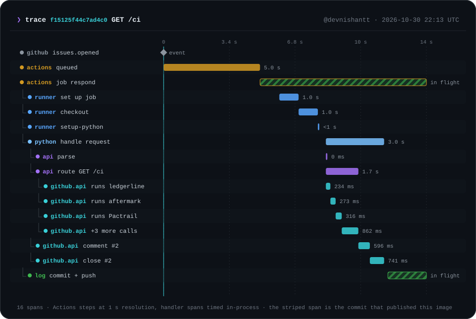
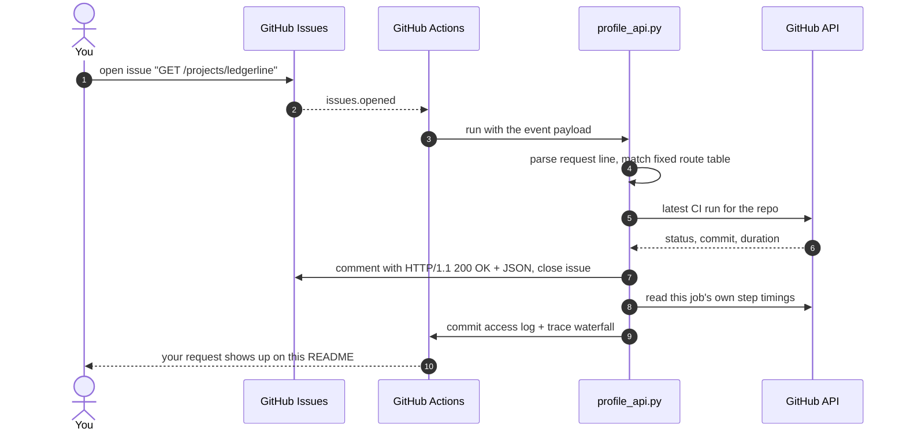

  

  <b>I build backends that are hard to get wrong.</b> 
  Money that never touches floating point, approvals that need a second person, audit trails you can verify, 
  and CI that typechecks, tests and builds on every push.

  <a href="#call"><code>call the api</code></a> &nbsp;·&nbsp;
  <a href="#work"><code>projects</code></a> &nbsp;·&nbsp;
  <a href="#ci"><code>pipelines</code></a> &nbsp;·&nbsp;
  <a href="#vitals"><code>vital signs</code></a> &nbsp;·&nbsp;
  <a href="#rules"><code>how i build</code></a> &nbsp;·&nbsp;
  <a href="#tools"><code>toolbox</code></a>

This README is served by a backend. **Open an issue whose title is an HTTP request** and a GitHub Action answers it
with an HTTP-style response (status line, headers, JSON body) in about 10 to 20 seconds. It then closes the issue,
writes your call into the access log below, and replaces the trace further down with a span-by-span waterfall of
*your* request. No server and no keys: the transport is GitHub Issues.

<table>
  <tr>
    <th align="left">Click one, then press <i>Create</i></th>
    <th align="left">What comes back</th>
  </tr>
  <tr><td><a href="https://github.com/devnishantt/devnishantt/issues/new?title=GET%20/about&body=Just%20press%20%2A%2ACreate%2A%2A%20%E2%80%94%20this%20issue%20is%20an%20HTTP%20request.%20A%20GitHub%20Action%20answers%20it%20in%20about%2020%20seconds%2C%20closes%20it%2C%20and%20adds%20you%20to%20the%20access%20log%20on%20my%20profile.%0A%0AChange%20the%20title%20to%20call%20any%20route%3A%20GET%20/%2C%20GET%20/about%2C%20GET%20/projects%2C%20GET%20/projects/%7Bname%7D%2C%20GET%20/ci%2C%20GET%20/stack%2C%20GET%20/now%2C%20OPTIONS%20/%2C%20BREW%20/coffee"><code>GET&nbsp;/about</code></a></td><td>Who I am, as JSON</td></tr>
  <tr><td><a href="https://github.com/devnishantt/devnishantt/issues/new?title=GET%20/projects&body=Just%20press%20%2A%2ACreate%2A%2A%20%E2%80%94%20this%20issue%20is%20an%20HTTP%20request.%20A%20GitHub%20Action%20answers%20it%20in%20about%2020%20seconds%2C%20closes%20it%2C%20and%20adds%20you%20to%20the%20access%20log%20on%20my%20profile.%0A%0AChange%20the%20title%20to%20call%20any%20route%3A%20GET%20/%2C%20GET%20/about%2C%20GET%20/projects%2C%20GET%20/projects/%7Bname%7D%2C%20GET%20/ci%2C%20GET%20/stack%2C%20GET%20/now%2C%20OPTIONS%20/%2C%20BREW%20/coffee"><code>GET&nbsp;/projects</code></a></td><td>Everything I'm building</td></tr>
  <tr><td><a href="https://github.com/devnishantt/devnishantt/issues/new?title=GET%20/projects/ledgerline&body=Just%20press%20%2A%2ACreate%2A%2A%20%E2%80%94%20this%20issue%20is%20an%20HTTP%20request.%20A%20GitHub%20Action%20answers%20it%20in%20about%2020%20seconds%2C%20closes%20it%2C%20and%20adds%20you%20to%20the%20access%20log%20on%20my%20profile.%0A%0AChange%20the%20title%20to%20call%20any%20route%3A%20GET%20/%2C%20GET%20/about%2C%20GET%20/projects%2C%20GET%20/projects/%7Bname%7D%2C%20GET%20/ci%2C%20GET%20/stack%2C%20GET%20/now%2C%20OPTIONS%20/%2C%20BREW%20/coffee"><code>GET&nbsp;/projects/ledgerline</code></a></td><td>One project: the hard part, the stack and its <b>live</b> CI status</td></tr>
  <tr><td><a href="https://github.com/devnishantt/devnishantt/issues/new?title=GET%20/ci&body=Just%20press%20%2A%2ACreate%2A%2A%20%E2%80%94%20this%20issue%20is%20an%20HTTP%20request.%20A%20GitHub%20Action%20answers%20it%20in%20about%2020%20seconds%2C%20closes%20it%2C%20and%20adds%20you%20to%20the%20access%20log%20on%20my%20profile.%0A%0AChange%20the%20title%20to%20call%20any%20route%3A%20GET%20/%2C%20GET%20/about%2C%20GET%20/projects%2C%20GET%20/projects/%7Bname%7D%2C%20GET%20/ci%2C%20GET%20/stack%2C%20GET%20/now%2C%20OPTIONS%20/%2C%20BREW%20/coffee"><code>GET&nbsp;/ci</code></a></td><td>Every pipeline, read live from GitHub Actions</td></tr>
  <tr><td><a href="https://github.com/devnishantt/devnishantt/issues/new?title=GET%20/now&body=Just%20press%20%2A%2ACreate%2A%2A%20%E2%80%94%20this%20issue%20is%20an%20HTTP%20request.%20A%20GitHub%20Action%20answers%20it%20in%20about%2020%20seconds%2C%20closes%20it%2C%20and%20adds%20you%20to%20the%20access%20log%20on%20my%20profile.%0A%0AChange%20the%20title%20to%20call%20any%20route%3A%20GET%20/%2C%20GET%20/about%2C%20GET%20/projects%2C%20GET%20/projects/%7Bname%7D%2C%20GET%20/ci%2C%20GET%20/stack%2C%20GET%20/now%2C%20OPTIONS%20/%2C%20BREW%20/coffee"><code>GET&nbsp;/now</code></a></td><td>Streak and contributions, computed when you ask</td></tr>
  <tr><td><a href="https://github.com/devnishantt/devnishantt/issues/new?title=DELETE%20/&body=Just%20press%20%2A%2ACreate%2A%2A%20%E2%80%94%20this%20issue%20is%20an%20HTTP%20request.%20A%20GitHub%20Action%20answers%20it%20in%20about%2020%20seconds%2C%20closes%20it%2C%20and%20adds%20you%20to%20the%20access%20log%20on%20my%20profile.%0A%0AChange%20the%20title%20to%20call%20any%20route%3A%20GET%20/%2C%20GET%20/about%2C%20GET%20/projects%2C%20GET%20/projects/%7Bname%7D%2C%20GET%20/ci%2C%20GET%20/stack%2C%20GET%20/now%2C%20OPTIONS%20/%2C%20BREW%20/coffee"><code>DELETE&nbsp;/</code></a></td><td><code>403</code>. This profile is append-only, like a good audit log</td></tr>
  <tr><td><a href="https://github.com/devnishantt/devnishantt/issues/new?title=BREW%20/coffee&body=Just%20press%20%2A%2ACreate%2A%2A%20%E2%80%94%20this%20issue%20is%20an%20HTTP%20request.%20A%20GitHub%20Action%20answers%20it%20in%20about%2020%20seconds%2C%20closes%20it%2C%20and%20adds%20you%20to%20the%20access%20log%20on%20my%20profile.%0A%0AChange%20the%20title%20to%20call%20any%20route%3A%20GET%20/%2C%20GET%20/about%2C%20GET%20/projects%2C%20GET%20/projects/%7Bname%7D%2C%20GET%20/ci%2C%20GET%20/stack%2C%20GET%20/now%2C%20OPTIONS%20/%2C%20BREW%20/coffee"><code>BREW&nbsp;/coffee</code></a></td><td>See RFC 2324</td></tr>
</table>

  

  

The trace is real. Queue time and runner steps are read back from the Actions API; the handler and every GitHub API call are timed in-process. The striped span is still running when the image is committed, because that commit is what publishes it.

<b>How it works</b>

 

- The issue title is untrusted input. It is read from the event payload (never interpolated into a shell), matched against a fixed route table, and only echoed back inside code fences.
- Concurrent requests never clobber each other: every log write re-reads `main`, appends, and retries the push.
- Unknown routes get `404`, malformed titles get `400`, and writes get `403` or `405`, with the reason in the body.
- Source: [`scripts/profile_api.py`](scripts/profile_api.py) · workflow: [`.github/workflows/profile-api.yml`](.github/workflows/profile-api.yml). Standard library only.

<table>
  <tr>
    <td width="50%"></td>
    <td width="50%"></td>
  </tr>
  <tr>
    <td width="50%"></td>
    <td width="50%"></td>
  </tr>
  <tr>
    <td width="50%"></td>
    <td width="50%"></td>
  </tr>
</table>

<b>The hard part of each one</b>

 

| Project | The hard part |
|---|---|
| [**Ledgerline**](https://github.com/devnishantt/ledgerline) | Integer minor-unit money, one-to-one matching that leaves ambiguous pairs unresolved instead of guessing, a separate reviewer credential for approvals, and a hash-linked audit chain that detects a missing tail. |
| [**Aftermark**](https://github.com/devnishantt/aftermark) | An incident only closes after two non-creator principals approve the *current* SHA-256 evidence manifest. New evidence makes old approvals stale. Every write claims the next revision, so conflicting writers roll back their whole batch. |
| [**Pactrail**](https://github.com/devnishantt/Pactrail) | A deliberately conservative OpenAPI diff: anything it can't prove safe is flagged for review and blocks CI. Backed by 639 tests, most of them schema boundary cases. |
| [**Tracebench**](https://github.com/devnishantt/tracebench) | Drift checks that report "incomparable" instead of quietly saying "stable". Bounded CSV/JSONL/Parquet ingestion, exact decimal bounds and fingerprinted, offline HTML reports. |
| [**bank-management-system**](https://github.com/devnishantt/bank-management-system) | A double-entry ledger you can check against the balances, transfers that lock rows in a fixed order so they can't deadlock, and `Idempotency-Key` retries that never double-charge. |
| [**Hospital-Management**](https://github.com/devnishantt/Hospital-Management) | Access and refresh token rotation, a Redis-backed token blacklist, rate limiting, uploads and email in a layered Express service. |

  

Read straight from the GitHub Actions API every day. If a pipeline goes red, this board goes red with it.

  

  

  

  

Nothing on this page is a third-party widget. Every graphic is a self-contained SVG rebuilt daily from the GitHub API by <a href="scripts/build_profile.py"><code>scripts/build_profile.py</code></a>, and the API above is <a href="scripts/profile_api.py"><code>scripts/profile_api.py</code></a>. Standard library only · icons from <a href="https://simpleicons.org">Simple Icons</a> (CC0)

