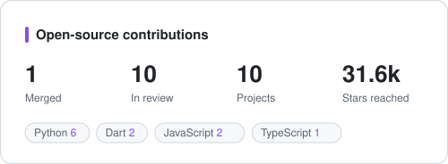

<h1 align="center">Hi, I'm Nishant 👋</h1>

  Backend developer working in TypeScript and Node.js, and an open-source contributor. 
  I build APIs and services, and I send small, well-tested fixes to projects I use.

---

### 🛠️ What I work with

  
  
  
  
  
  
  
  
  
  
  
  

---

### 🌍 Open source

  

<!-- oss:start -->

**1 merged · 10 in review · 10 projects · 31.6k combined stars**

#### 🟣 Merged

| Project | ★ | Pull request |
|---|---:|---|
|  [foss42/apidash](https://github.com/foss42/apidash) | 2.9k | [#1828](https://github.com/foss42/apidash/pull/1828) fix: preserve disabled env vars after JS script execution |

#### 🟢 In review

| Project | ★ | Pull request |
|---|---:|---|
|  [processing/p5.js](https://github.com/processing/p5.js) | 24.3k | [#9226](https://github.com/processing/p5.js/pull/9226) fix(core): keep pixelDensity when createCanvas replaces the renderer |
|  [foss42/apidash](https://github.com/foss42/apidash) | 2.9k | [#1834](https://github.com/foss42/apidash/pull/1834) feat: add GraphQL variables JSON editor |
|  [jjjake/internetarchive](https://github.com/jjjake/internetarchive) | 1.9k | [#811](https://github.com/jjjake/internetarchive/pull/811) Honor ignore_existing during Item.download dry_run |
|  [CrossGL/crosstl](https://github.com/CrossGL/crosstl) | 1.7k | [#3612](https://github.com/CrossGL/crosstl/pull/3612) Number HIP __constant__ bindings as the CUDA importer does |
|  [zulip/python-zulip-api](https://github.com/zulip/python-zulip-api) | 407 | [#924](https://github.com/zulip/python-zulip-api/pull/924) zulip: Optionally retry requests that hit RATE_LIMIT_HIT. |
|  [mloda-ai/mloda](https://github.com/mloda-ai/mloda) | 98 | [#2427](https://github.com/mloda-ai/mloda/pull/2427) test: share the young-first gc reclaim loop in tests/helpers |
|  [accordproject/template-playground](https://github.com/accordproject/template-playground) | 77 | [#996](https://github.com/accordproject/template-playground/pull/996) fix(build): emit index.html for known SPA routes so S3 deep links return 200 |
|  [aboutcode-org/license-expression](https://github.com/aboutcode-org/license-expression) | 74 | [#141](https://github.com/aboutcode-org/license-expression/pull/141) Bump setuptools build requirement and drop unused wheel |
|  [CCExtractor/sample-platform](https://github.com/CCExtractor/sample-platform) | 30 | [#1220](https://github.com/CCExtractor/sample-platform/pull/1220) [FIX] Add timeouts on outbound HTTP calls outside mod_ci |
|  [ohcnetwork/create-care-mfe-plug](https://github.com/ohcnetwork/create-care-mfe-plug) | 3 | [#8](https://github.com/ohcnetwork/create-care-mfe-plug/pull/8) feat: add decimal utility helpers to the plugin template |

Auto-updated daily from the GitHub API · last run 2026-10-30

<!-- oss:end -->

---

### 📦 Things I've built

| Project | What it is | Stack |
|---|---|---|
| [**Hospital-Management**](https://github.com/devnishantt/Hospital-Management) | Hospital management backend: JWT access and refresh tokens with rotation, Redis-backed token blacklist, rate limiting, file uploads and email | TypeScript · Express · Prisma · PostgreSQL · Redis |
| **Flight booking microservices** [gateway](https://github.com/devnishantt/API-Gateway-Flights) · [auth](https://github.com/devnishantt/Auth-Service) · [flights](https://github.com/devnishantt/Flight-Service) · [booking](https://github.com/devnishantt/Flight-Booking-Service) | Four services behind an API gateway with JWT auth and proxying; bookings check seats with the flight service, and a cron job cancels stale bookings | Node.js · Express · Sequelize · MySQL |
| [**TwitterClone**](https://github.com/devnishantt/TwitterClone) | Microblogging API with cookie-based JWT auth, Zod validation and rotating log files | TypeScript · Express · Prisma · PostgreSQL |
| [**Movie-Booking-Backend**](https://github.com/devnishantt/Movie-Booking-Backend) | Movie ticket booking API | TypeScript · Express · Prisma · PostgreSQL |
| [**Tea-Code-Problem-Service**](https://github.com/devnishantt/Tea-Code-Problem-Service) | Problem service for a coding judge: problems written in Markdown and sanitized before storage | Node.js · Express · MongoDB |

---

### 🤝 How I contribute

- **Read first.** I read the issue, the code around it and the contributing guide before writing anything.
- **Small and focused.** One problem per PR, with tests that fail before the fix and pass after it.
- **Honest descriptions.** I say what I tested and what I couldn't, and I keep PRs up to date until they're merged or closed.

The open-source section updates itself every day through a GitHub Action in this repository.

