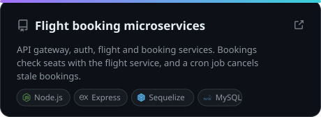
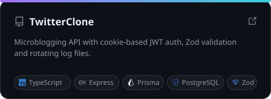
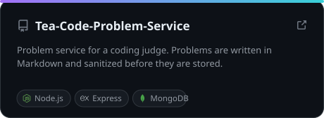

  

  I build APIs and services in TypeScript and Node.js, and I send small, well-tested fixes to open-source projects. 
  Everything below is drawn from live GitHub data and redrawn by a GitHub Action every day.

  

  

<b>Every pull request, with links</b>

 

<!-- oss:start -->

| | Project | ★ | Pull request |
|---|---|---:|---|
| 🟣 | [foss42/apidash](https://github.com/foss42/apidash) | 2.9k | [#1828](https://github.com/foss42/apidash/pull/1828) fix: preserve disabled env vars after JS script execution |
| 🟢 | [processing/p5.js](https://github.com/processing/p5.js) | 24.3k | [#9226](https://github.com/processing/p5.js/pull/9226) fix(core): keep pixelDensity when createCanvas replaces the renderer |
| 🟢 | [foss42/apidash](https://github.com/foss42/apidash) | 2.9k | [#1834](https://github.com/foss42/apidash/pull/1834) feat: add GraphQL variables JSON editor |
| 🟢 | [jjjake/internetarchive](https://github.com/jjjake/internetarchive) | 1.9k | [#811](https://github.com/jjjake/internetarchive/pull/811) Honor ignore_existing during Item.download dry_run |
| 🟢 | [CrossGL/crosstl](https://github.com/CrossGL/crosstl) | 1.7k | [#3612](https://github.com/CrossGL/crosstl/pull/3612) Number HIP __constant__ bindings as the CUDA importer does |
| 🟢 | [zulip/python-zulip-api](https://github.com/zulip/python-zulip-api) | 407 | [#924](https://github.com/zulip/python-zulip-api/pull/924) zulip: Optionally retry requests that hit RATE_LIMIT_HIT. |
| 🟢 | [mloda-ai/mloda](https://github.com/mloda-ai/mloda) | 98 | [#2427](https://github.com/mloda-ai/mloda/pull/2427) test: share the young-first gc reclaim loop in tests/helpers |
| 🟢 | [accordproject/template-playground](https://github.com/accordproject/template-playground) | 77 | [#996](https://github.com/accordproject/template-playground/pull/996) fix(build): emit index.html for known SPA routes so S3 deep links return 200 |
| 🟢 | [aboutcode-org/license-expression](https://github.com/aboutcode-org/license-expression) | 74 | [#141](https://github.com/aboutcode-org/license-expression/pull/141) Bump setuptools build requirement and drop unused wheel |
| 🟢 | [CCExtractor/sample-platform](https://github.com/CCExtractor/sample-platform) | 30 | [#1220](https://github.com/CCExtractor/sample-platform/pull/1220) [FIX] Add timeouts on outbound HTTP calls outside mod_ci |
| 🟢 | [ohcnetwork/create-care-mfe-plug](https://github.com/ohcnetwork/create-care-mfe-plug) | 3 | [#8](https://github.com/ohcnetwork/create-care-mfe-plug/pull/8) feat: add decimal utility helpers to the plugin template |

🟣 merged · 🟢 in review · refreshed 2026-10-30

<!-- oss:end -->

  

<table>
  <tr>
    <td width="50%"></td>
    <td width="50%"></td>
  </tr>
  <tr>
    <td width="50%"></td>
    <td width="50%"></td>
  </tr>
</table>

### How I contribute

- **Read first.** The issue, the code around it and the contributing guide, before any code.
- **One problem per PR,** with a test that fails before the fix and passes after it.
- **Honest descriptions.** What I tested, what I couldn't, and follow-through until it's merged or closed.

Graphics generated by <a href="scripts/build_profile.py"><code>scripts/build_profile.py</code></a> from the GitHub API, no third-party services · icons from <a href="https://simpleicons.org">Simple Icons</a> (CC0)

